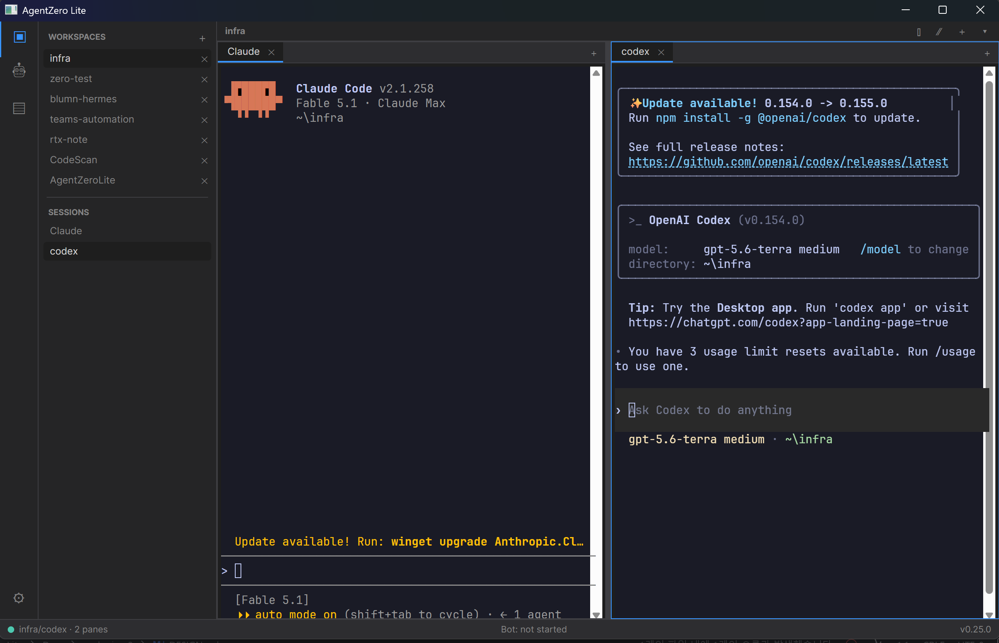

# AgentZero Lite — Avalonia host (Windows + macOS)

> 🇰🇷 한국어: [README-Avalonia-KR.md](README-Avalonia-KR.md) · Main manual: [README.md](README.md) · Design record: [Docs/avalonia-v2/DESIGN.md](Docs/avalonia-v2/DESIGN.md)



AgentZero Lite ships **two GUI hosts over one shared core**:

| | WPF host (`Project/AgentZeroWpf`) | Avalonia host (`Project/AgentZeroAvalonia`) |
|---|---|---|
| Runs on | Windows | Windows **and macOS** (arm64 `.app`) |
| Role | **Windows-first lab / reference build** — every feature is built and tried here first | **The official edition** (since v0.25.4) — Releases installer, Microsoft Store; macOS once checked on a Mac; takes in what proved its worth |
| Terminal | xterm.js in WebView2 + ConPTY | xterm.js in `NativeWebView` + ConPTY (Windows) / Porta.Pty (macOS) |
| Shared | `Project/ZeroCommon`: actors, agent loop, tool catalog, stores, SQLite, CLI JSON contract | same |

## The strategy: WPF first, then converge

WPF is not being replaced. It is the fastest place to try things on Windows — the UI stack is mature, the
tooling is quick, and most of the team's day is spent there. Ideas land in WPF, get used, and the ones that
earn their keep are **converted** into the Avalonia host so they reach macOS too. The conversion itself is a
skill worth keeping sharp: every feature that goes through it comes out with its logic in `ZeroCommon` and its
UI thin, which makes the next conversion cheaper.

Rules that keep the two hosts honest:

1. **Anything without a UI dependency lives in `ZeroCommon`.** If a WPF feature cannot be converted without
   copying logic, the logic was in the wrong place; move it down first.
2. **Both hosts read and write the same data** — the SQLite file, the settings JSON files, the alias registry,
   the terminal split layout. A workspace arranged in one host opens identically in the other.
3. **The CLI is one contract.** `AgentZeroLite -cli …` sends and receives the same JSON in both hosts; only the
   transport differs (WM_COPYDATA on WPF, a named pipe on Avalonia). `-cli help agentzero` applies to both.
4. **Converting a feature never edits the WPF project.** The regression gate is `git diff --stat main -- Project/AgentZeroWpf`
   being empty for the conversion commits. Shared fixes go into `ZeroCommon` and benefit both.
5. **Windows-only pieces stay Windows-only, fenced by `OperatingSystem.IsWindows()`** (local LLM via LLamaSharp,
   DPAPI, BLE, OS automation). macOS gets the External-provider path and AES-GCM secrets instead.

## Stack

| Layer | Package / component | Version | Notes |
|---|---|---|---|
| Runtime | .NET | 10.0 (`net10.0`) | plain TFM — no `-windows` suffix on the Avalonia host or ZeroCommon |
| UI | Avalonia · Avalonia.Desktop · Avalonia.Themes.Fluent · Avalonia.Fonts.Inter | 12.1.2 | MIT |
| Web view | Avalonia.Controls.WebView (`NativeWebView`) | 12.1.0 | WebView2 on Windows, WKWebView on macOS |
| MVVM | CommunityToolkit.Mvvm | 8.4.0 | `ObservableObject`, `[RelayCommand]` |
| Terminal renderer | xterm.js (+ fit, web-links, webgl add-ons) | 5.5.0 (vendored) | shared with the WPF host from `Project/AgentZeroWpf/Wasm/xterm/vendor` |
| PTY (Windows) | ConPTY via kernel32 P/Invoke (`ConPtyHost`) | Windows 10 1809+ | no native DLLs shipped |
| PTY (macOS / Linux) | Porta.Pty | 2.2.2 | forkpty shim, natives bundled |
| Actors | Akka · Akka.Streams · Akka.DependencyInjection | 1.5.67 | same topology as the WPF host |
| Persistence | Microsoft.EntityFrameworkCore.Sqlite · SQLitePCLRaw.bundle_e_sqlite3 | 10.0.0-preview.3 · 3.0.3 | one DB file for both hosts |
| Secrets | System.Security.Cryptography.ProtectedData (DPAPI, Windows) · AES-GCM file key (elsewhere) | 10.0.0 | `SecretProtection.Protector` |
| Local LLM (Windows only) | LLamaSharp | 0.26.0 | External providers (OpenAI-compatible REST) on every OS |
| Fonts | JetBrains Mono | OFL 1.1 | vendored with the xterm bundle |

## Build, run, test

```bash
dotnet build Project/AgentZeroAvalonia/AgentZeroAvalonia.csproj -c Debug                 # Windows
dotnet build Project/AgentZeroAvalonia/AgentZeroAvalonia.csproj -c Release -r osx-arm64  # macOS cross-compile
dotnet publish Project/AgentZeroAvalonia/AgentZeroAvalonia.csproj -c Release -r linux-x64 --self-contained true -p:UseAppHost=true -o publish-avalonia/linux-x64  # Linux, also from Windows
dotnet test  Project/AgentZeroAvalonia.Tests/AgentZeroAvalonia.Tests.csproj             # headless, both OSes

Project/AgentZeroAvalonia/bin/Debug/net10.0/AgentZeroLite.exe                            # GUI
Project/AgentZeroAvalonia/bin/Debug/net10.0/AgentZeroLite.exe -cli status                # drive it from a shell
Project/AgentZeroAvalonia/bin/Debug/net10.0/AgentZeroLite.exe -cli selftest all          # ipc · secrets · pty, no display needed
```

Rider/VS: open `AgentZeroLite.slnx`, pick the run profile **AgentZeroLite (Avalonia GUI)**. The WPF and Avalonia
GUIs share one single-instance mutex on Windows, so close one before starting the other.

**A Debug build runs beside the installed release** (`BuildFlavor`): it has its own single-instance mutex
(`AgentZeroLite-Debug`), its own CLI pipe (`AgentZeroLite.cli.debug` — a Debug exe's `-cli` drives the Debug GUI),
`-DEBUG` in every window title, and its own **data profile** `%LOCALAPPDATA%\AgentZeroLite-Debug` (DB, settings,
logs, plugins — `AppPaths.UseProfile`). The profile is seeded once from the release's data (settings JSON + a
`VACUUM INTO` snapshot of the DB, safe while the release has it open); delete the folder to seed again. Downloaded
models stay shared (`AppPaths.SharedRoot`). The profile name reaches the wearable host through
`AGENTZEROLITE_PROFILE`; terminal tabs drop it.

Releases (official, `release.yml` on a `v*` tag): `AgentZeroLite-v<ver>-Setup.exe` (Inno Setup, `installer/AgentZeroLite.iss` —
it carries the AppId the WPF installer used, so it upgrades a WPF install in place, and it includes `wearable\`),
`AgentZeroLite-v<ver>-win-x64.zip`; the macOS zip is built by the same run but kept as the `macos` artifact
until the [macOS smoke checklist](Docs/avalonia-v2/macos-smoke.md) has been run on a Mac. The WPF reference installer is on demand:
`release-wpf.yml` (`installer/AgentZeroLite-WPF.iss`, its own AppId and folder) attaches `AgentZeroLite-WPF-v<ver>-*` to a release.

macOS (testers): download the `macos` artifact of a *Build & Release* run (or `AgentZeroLite-Avalonia-osx-arm64`
of an *Avalonia host* run), unzip, then
`xattr -dr com.apple.quarantine AgentZeroLite.app` (the bundle is ad-hoc signed) and open it. The CLI wrapper is
`AgentZeroLite.app/Contents/MacOS/AgentZeroLite.sh`. Hand checklist: [Docs/avalonia-v2/macos-smoke.md](Docs/avalonia-v2/macos-smoke.md).

Linux (Ubuntu desktop, test build): `Project/AgentZeroAvalonia/linux/build-deb.sh <publish-dir> <out-dir> <version>`
turns a linux-x64 publish into `AgentZeroLite-v<ver>-linux-x64.deb` (installs to `/opt/agentzerolite`, `agentzerolite`
on PATH, app-menu entry + icons; `Depends` WebKitGTK 4.1, GTK 3, ICU, OpenSSL, fontconfig — `sudo apt install ./….deb`
pulls them) and a portable `.tar.gz`. Both CI workflows build them; the job installs its own `.deb` and runs it.
Users install with `curl -fsSL https://psmon.github.io/AgentZeroLite/Home/install-linux.sh | bash` (`Home/install-linux.sh`:
newest `v*` release's `.deb`, downloaded into `/tmp` and installed with apt). A `.deb` installed straight from `~/Downloads`
makes apt print *"couldn't be accessed by user '_apt' … (13: Permission denied)"* — Ubuntu homes are `0750`, so apt's
sandbox user cannot read it; harmless, but it reads like a failure, hence `/tmp`.
**Trying the GUI without a Linux machine** (Windows 11 + Docker Desktop, shown through WSLg — no X server to install):
`docker build -t azl-ubuntu-gui Project/AgentZeroAvalonia/linux/test`, then
`bash Project/AgentZeroAvalonia/linux/test/run-gui.sh publish-avalonia/linux-x64` (interactive),
`… --terminal` (seeds a workspace, opens a bash tab, types and reads it back, saves a screenshot) or
`install-test.sh <deb>` (apt-installs the package into a fresh `ubuntu:24.04`). `run-tests.sh` runs the headless
suites in the .NET SDK container. What Linux lacks today: audio capture, OS control, plugin frame capture, local LLM,
SSH definitions, the wearable host — the same fences as macOS.

Microsoft Store (Windows): `Project/AgentZeroAvalonia/msix/build-msix.ps1` builds the MSIX (x64, the Store signs
it). The Store edition keeps its own data (database, settings) isolated in the package — by design; it does
not share them with the regular install — while terminal tabs and the settings installer start their processes
with the desktop-app breakaway policy (`DesktopAppBreakaway`), so whatever the user installs or runs there
(npm -g, claude, git…) lands in the real profile. The only restricted capability is `runFullTrust`.
Procedure, local checks and paste-ready listing text (in Korean):
[Docs/avalonia-v2/microsoft-store.md](Docs/avalonia-v2/microsoft-store.md).

## Converted so far

| Area | Status | Notes |
|---|---|---|
| Shell: activity bar, workspace sidebar, status bar, bot pane | ✅ | `MainWindow`, `MainWindowViewModel` |
| Workspaces + terminal tabs, persisted in the shared DB | ✅ | same `CliGroups/CliTabs` rows as WPF |
| Terminal: xterm.js renderer, appearance, IME, links, health banner | ✅ | ConPTY copy on Windows, Porta.Pty on macOS |
| Split panes (right/down, close, move tab, focus by direction), layout restore | ✅ | `WorkspaceLayout<T>`; `CliGroup.LayoutJson` byte-identical to WPF |
| Detach a terminal into its own window and dock it back (WPF's Float / Dock): tab menu, the pane's ⤢/⤡, Ctrl+Alt+F / Ctrl+Alt+D, `-cli layout float\|dock` | ✅ Windows · ⏳ macOS check | the tab's own renderer is moved into a `TerminalWindow` in one dispatcher turn, so the web view, its scrollback and the PTY carry on (measured on Windows); the tab stays in its pane's layout, which is where docking returns it, and the saved layout is unchanged — a restart brings every tab back docked. Closing the window docks it; split/move refuse a detached tab, as in WPF |
| Hotkeys, incl. while the renderer has focus | ✅ | one table; Ctrl→Cmd on macOS |
| **Command palette** (WPF's Ctrl+J popup) on **Ctrl+Shift+P** (Cmd on macOS), also inside a focused terminal: fuzzy search over every terminal (with its agent state) and workspace, a new terminal of each definition, every chord command, the code panel's faces (files, git log, diff, AI changes), every page and settings section; ↑↓ / Enter / Esc. **Settings → Shortcuts**: every command this host runs, its default, your keys (blank = default, `none` = free the keys for the terminal), conflicts named; a save rebinds live in every open terminal | ✅ Avalonia first · ⏳ WPF keeps Ctrl+J | not Ctrl+J: in a terminal that is a line feed and Claude Code's newline key. `HotkeyTable.Effective` now reads user bindings for all of this host's ids (not only WPF's `WindowCommandIds`), user keys first, `none` removes a default; the page validates with that same function so it never disagrees with the keys. `shortcut-settings.json` is shared: entries this host does not run are kept, and its switch is turned on only once something is rebound here. The palette is its own window (macOS overlay rule) over ZeroCommon `FuzzyMatcher` |
| AgentBot: CHT / KEY / AI modes, progress + tool cards, handshake | ✅ | same actor topology (`/user/stage/bot/loop`) |
| AgentBot UX: approval toast + auto-approve, URL bubbles, session header, clipboard attachment, key chords, selectable text | ✅ | `AgentEventStream` per active terminal; rules shared in `ZeroCommon/Agents` |
| AgentBot as a docked pane **and** a floating window (Ctrl+Shift+`) | ✅ | one view model, two views; docked along the **bottom** as in WPF (280px, splitter, maximize keeps a 90px sliver of terminal), spanning everything but the activity bar. A sibling row, never an overlay — an Avalonia surface drawn over the terminal's native web view is invisible on macOS. WPF's other bottom tabs (OUTPUT/LOG/NOTE) are not converted, so there is no tab strip |
| **Code view** — the active workspace's files in the bottom panel (VS Code's explorer + a read-only editor; the WPF host's NOTE file tree + document viewer): 📄 on the activity bar, Ctrl+Alt+E, `-cli code open [path] \| close \| status` | ✅ Windows · ⏳ macOS check | the bottom panel is now tabbed, VS Code style — 🤖 BOT \| 📄 CODE share one dock (height, maximize); ⧉ / ✕ act on the tab in front and the code view floats into its own window like the bot. Highlighting is VS Code's own TextMate grammars + Dark+ (AvaloniaEdit 12 + AvaloniaEdit.TextMate, ~8 MB incl. `libonigwrap`). File rules in ZeroCommon `Workspace/WorkspaceFiles` (folder-at-a-time listing off the UI thread, the WPF tree's ignore list + simple `.gitignore`, binary sniff, 2 MB view cap, containment). Markdown opens **rendered** (Markdig in ZeroCommon `Workspace/MarkdownHtml`: GFM tables/task lists, YAML front matter hidden, raw HTML escaped, workspace images inlined as data URIs) with **mermaid diagrams** drawn by the WPF host's offline `mermaid.min.js` (linked, served from `Wasm/markdown` by its own loopback asset server, CSP: own-origin scripts only); **◧ Preview / ‹› Plain** switches to the source, links open the workspace file or the browser; `-cli code view preview\|plain`, and `code status` reports `mermaid n/n` drawn. Not yet: PDF, editing |
| Tool belt: terminals, files, `find_files/open_file/stop_media`, web (headless) | ✅ | `WorkspaceToolHost` |
| Settings: External LLM (+ test), CLI definitions CRUD, terminal appearance (live) | ✅ | Local LLM section on Windows only |
| Settings: agent CLI install (Claude, Codex, AgentOne, Netclaw, Hermes) | ✅ both hosts | A built-in row is a shell plus an agent command, so it stays valid while the agent was never installed — the tab then prints "claude : The term 'claude' is not recognized", which reads as a broken app. Selecting such a definition shows whether the tool is on PATH and offers to fetch it: **npm -g on every OS** for the npm tools (`@anthropic-ai/claude-code` / `@openai/codex` / `@webnori/agent-one`; winget was dropped because its packages lagged releases and exist for Windows only), and the **vendor's install script** for Netclaw and Hermes, which are not on npm. AgentOne and Netclaw rows launch `agent-one chat` / `netclaw chat` (their bare commands print help). Rules and packages live in `ZeroCommon/Services/AgentCliTools`; WPF adopted the same panel in its CLI Definitions tab |
| App icon | ✅ | The WPF host's `agentzero.ico`, linked into the project as the exe icon and the window icon; `macos/AgentZeroLite.icns` is generated from the same file for the `.app` bundle |
| AgentBot: "⚑ Report" on every AI answer (Microsoft Store policy 11.16) | ✅ Avalonia first · ⏳ WPF | report panel (category + note) opens a pre-filled e-mail or GitHub issue quoting the answer; logic in `ZeroCommon/Llm/AiContentReport` so the WPF bot window can reuse it. Built here first because Store certification required it |
| Settings: AI-mode tool-chain turn budget | ✅ (also back-ported to WPF) | `AgentLoopMaxTurns` (default 12, clamped 1–200) → `AgentLoopOptions.MaxIterations`. Both hosts passed only the per-turn token cap and the temperature, leaving the budget a constant, so a long job could only end in "max iterations (12) reached without 'done'". Built here, then applied to WPF's `AgentBotWindow` + *AIMODE Turns* in its LLM tab, so the shared settings file means one number for both |
| Settings: **MCP servers** for AI mode — stdio / Streamable HTTP / SSE, header & env values sealed, per-tool allow switch, test call, `mcpServers` JSON import | ✅ Avalonia first · ⏳ WPF | `ZeroCommon/Mcp` (own client: `McpClient` + three transports, `McpSettingsStore` → `mcp-settings.json`, `McpHub`). The agent sees each allowed tool as `server.tool` (`memorizer.search`): `AgentLoopOptions.DynamicTools` adds the names to the loop's known set, to the local GBNF and to the system prompt; the call goes to `IAgentToolbelt.CallDynamicToolAsync`. The prompt is built from the tool lists cached at *Load tools*, so starting a session never waits on a server; the allow list is enforced again at call time. Arguments are coerced to the tool's schema (`"5"` → 5, `"a, b"` → array) because the local grammar emits strings only. Changes reach the next AI session (↻ New session). WPF needs only its toolbelt and options factory wired to `McpHub` plus a settings tab |
| CLI: status, terminal-list/send/key/read/wait/alias (`--alias`), layout, bot-chat, bot-ask, web, mcp, selftest | ✅ | pipe `AgentZeroLite.cli`; `.ps1` / `.sh` wrappers |
| Remote shell (SSH) definitions: composed `ssh` launch + stored-password autofill | ✅ Windows / ⏳ macOS | composition moved into `TerminalLaunchPlanner` (WPF composes at its own call sites, unchanged); autofill is `ZeroCommon/Services/SshPasswordWatcher`. The password column is shared with WPF, so this host seals it with `Security/SshPasswordVault` (same DPAPI entropy, no marker). On macOS remote definitions stay hidden — `ComposeArguments` only knows cmd/PowerShell wrappers |
| CI: windows-latest + macos-14, win-x64 zip, `.app` bundle | ✅ | `.github/workflows/avalonia-build.yml` |
| **Linux (Ubuntu desktop x64)**: build, headless suites, self-test, `.deb` + `.tar.gz`, release assets | ✅ build · ⏳ desktop check by a person | Job C in `avalonia-build.yml` and a `linux` job in `release.yml` (does not hold back Windows). Measured in Docker + WSLg on Ubuntu 24.04: the GUI maps, a bash tab runs through Porta.Pty and the WebKitGTK renderer (send + screen read-back), the code view renders Markdown, `-cli` answers over its Unix-socket pipe. Fixed on the way: POSIX rows assumed `/bin/zsh` (stock Ubuntu has none) — now `ZeroCommon/Platform/PosixShell` seeds the shells that exist and launches agents through `$SHELL` or bash; and `LocalApplicationData` is `""` on a fresh Unix account, which put the data folder in the working directory — `AppPaths.LocalAppData` now creates it |
| Settings: Voice (STT Whisper.net / OpenAI, TTS Supertonic / OpenAI, model downloads, mic-free Speak + Round trip test) | ✅ | Same `voice-settings.json` as WPF and the wearable host. Portable pieces moved to ZeroCommon: `Voice/WhisperNetStt` (the WPF `WhisperLocalStt` minus the WMI GPU pick), `Voice/WavPcm` (WAV → 16 kHz mono without NAudio), `Voice/PortableVoiceRuntime` (builds the providers a non-WPF host can run). Playback is `Services/WavPlayer`: winmm `PlaySound` (async, so Stop is immediate) on Windows, `afplay` on macOS. A save writes only the page's fields and keeps a WPF-only provider (SAPI, LocalGemma) selected; with Supertonic it writes the voice to both `TtsVoice` and `SupertonicVoice` — measured, they had drifted (desktop M2, watch F1). Mic capture is still the AgentBot-voice row below |
| Model loading: on use, on Save, at startup (opt-in per kind) | ✅ Avalonia first · ⏳ WPF | `ZeroCommon/Models/ModelResidency`. Voice models stay loaded once per process (the Voice tab's test reloaded them per click); Save loads the chosen voice/ear in the background and frees the replaced voice; AI mode loads the local model on its first turn (no Load press needed); "Load at startup" boxes on the LLM and Voice pages (`model-preload.json`, all off by default) load in the background after the window opens |
| Settings: Voice — **KittenTTS 2** (on-device, multilingual incl. Korean, Windows) | ✅ Avalonia first · ⏳ WPF | Speech LM as a Q8_0 GGUF on the app's llama.cpp (Vulkan), chatterbox-turbo decoder on CPU ONNX, text normalization ported to C# (`Voice/KittenTts2`). Picker: voice from the installed bundle's manifest, the answer language, and the device (Auto / GPU / CPU — CPU for machines without a usable GPU); Download fetches the ~3.3 GB bundle from AgentZero's GitHub Release `model-kittentts2-v1` (resumable, SHA-256 per file); Install copies one from a folder. Desktop and watch speak through the same `IVoiceEngine` (`VoiceEngines.Create`), which also replaced the wearable host's per-engine code. WPF's voice page does not list it: saving voice settings there turns TTS Off |
| Wearable page: link / brain / allowed folders / on-connect settings, Start / Stop / Test brain / Test HUD, live host log | ✅ Windows | `ZeroCommon/Wearable/WearableHostLauncher` (WPF's `WearableHostProcess` + the kill-on-close Job Object, moved down) and `WearableDiagnostics`; activity-bar ⌚, hidden off Windows because the host is WinRT BLE. The page also shows the built-in **`home`** work folder and the **OS control** switch (the watch's desktop tools, with an audit-log link); the rules live in ZeroCommon (`Wearable/Actors/OsToolActor`, `Os/IOsControl`). The csproj builds `ZeroWearable` and copies/publishes it into `wearable\` on Windows builds only. **Not in the Store MSIX yet** (`build-msix.ps1` passes `-p:IncludeWearableHost=false`): a BLE child process in the package is its own certification question |
| AgentBot skills: SkillSync, starter-pack import, `.agent-zero/` cache, slash autocomplete | ⏳ not yet | one dependency chain — the slash list is empty without SkillSync, which drives the Claude CLI through a Windows-only shell probe |
| Settings: Voice — **Streaming STT** (sherpa-onnx `OnlineRecognizer`; **Nemotron 3.5 ASR is the official model**, Korean Zipformer the light alternative; text while speaking) | ✅ | `SherpaStreaming` is the first STT provider in `PortableVoiceRuntime` (`CreateStreamingStt` for the live mic, `StreamingSttBatchAdapter` for Round trip, voice notes and "load at startup"). The page adds the model picker (Nemotron marked *official*), Download (k2-fsa `asr-models` release), the endpoint silence (ms) and **🎙 Listen live**: microphone → the chosen model, words shown in *Heard* as they are spoken |
| AgentBot voice — **mic input** (🎙 in the composer) | ✅ Windows · ⏳ macOS | `ZeroCommon/Voice/Streaming/VoiceMicSession` feeds the shared capture layer's microphone into ZeroCommon's voice actor (`/user/stage/voice`, the same Akka.Streams graph WPF uses). With the streaming provider the recognizer's partials fill the input box and its endpoint sends the sentence (measured on a Korean clip at real-time pace: sent ~0.9 s after the speaker stops); any other provider runs the VAD + batch graph. A partial is never sent — the agent loop starts on settled words. macOS needs an `IAudioCapturePlatform` (no microphone there yet, so 🎙 is hidden) |
| AgentBot voice — TTS of answers, barge-in, mute, delegation | ⏳ not yet | the voice actor's OUTPUT graph is in ZeroCommon; the playback queue (`IAudioPlaybackQueue`) is NAudio-only in WPF |
| **Plugins** page (WPF's WebDev): built-in samples + installed plugins, install from the official list / a GitHub folder URL / a .zip, uninstall, one cached web view per plugin; voice note, live music and vision included | ✅ Windows · ⏳ macOS | Plugins written for WPF run **unchanged**. The op table moved down to `ZeroCommon/Browser/ZeroBridgeDispatcher` (WPF's `WebDevBridge` now carries messages to it), the portable host to `ZeroBrowserCore` (chat, summarize, classify, oEmbed, YouTube/MP3 playlists, vision on a given frame), the shared events to `ZeroBridgeEvents`, the `mp3.local` path/Range rules to `Mp3Resource`, and manifest / catalog / installer to `ZeroCommon/Browser/Plugins`. `zero-bridge.js` is linked byte-identical from WPF; `Services/Plugins/PluginAssetServer` serves `zero.local` / `plugin.local` / `mp3.local` over loopback (text responses rewritten, port remembered so `localStorage` survives) and injects `Wasm/common/zero-webview-shim.js` first, which stands in for `chrome.webview` on both engines. Same plugins folder as WPF. **Voice note / live music**: the pipelines (VAD, STT, diarization, AST loop) moved into `ZeroBrowserCore` over ZeroCommon's `Audio/IAudioCapturePlatform` — `WindowsAudioCapture` (NAudio WaveIn + WASAPI loopback, the code WPF's capture services now wrap) on Windows, `UnsupportedAudioCapture` (→ `ok:false, unsupported-host`) elsewhere. **Vision**: `Services/Plugins/IWebViewFrameCapture` — `WebView2FrameCapture` calls `ICoreWebView2::CapturePreview` (vtable slot 30) through `IWindowsWebView2PlatformHandle`. Measured on Windows through `-cli plugin call`: Whisper medium (GPU) transcribed loopback speech with a Sherpa speaker label, AST classified a 440+880 Hz tone as "Sine wave 91%", Florence-2 ran on a captured plugin frame in 952 ms. macOS needs an `IAudioCapturePlatform` (AVAudioEngine / ScreenCaptureKit) and an `IWebViewFrameCapture` (WKWebView snapshot) — not started. Not yet: detach-to-floating-window |
| Detach a plugin into its own window and dock it back (WPF's FloatingWebDevWindow): **⧉ Detach** on the Plugins toolbar, 📌 always-on-top, opacity, `-cli plugin detach\|dock <id>` | ✅ Windows · ⏳ macOS check | the plugin's own web view is moved into a `PluginWindow` in one dispatcher turn, so its page keeps running (bridge calls and `vision` frame capture work from the window). Pin, opacity and the window's rect are remembered per plugin in WPF's `WebDev\floating-prefs.json` (ZeroCommon `PluginWindowPrefs`, dips like WPF), so both hosts restore the same spot; the window has no owner, so it stays up beside the terminals when the main window is minimized. Closing it docks the plugin |
| Settings → **Models**: AST AudioSet, Florence-2, Sherpa diarization — status, download, speaker-label switch | ✅ | the ZeroCommon downloaders WPF's Music / Vision / Diarization tabs call; same `models\` folder and `diarization-settings.json` |
| Sidebar **ACTIVE SESSIONS**: every running terminal of every workspace, click to go there; agent state per row (blocked / working / done / idle dot + chip), attention count in the header and the window title | ✅ | the WPF SESSIONS panel's herdr H1/H2 state. Detection moved down to `ZeroCommon/Agents/AgentActivityTracker` (WPF's `AgentStateMonitor` now drives it on its timer), so both hosts classify screens with the same manifests and "seen" rule; `-cli agent-state` answers the WPF contract. Claude Code tabs use Claude's own status file (`~/.claude/sessions/<pid>.json`: busy / waiting / idle) before the screen, Codex tabs the turn events of their thread's rollout (`task_started` / `task_complete`) — a finished turn shows as **done** within a second |
| **Agent-needs-you notifications**: when a terminal's agent turns blocked or finishes a turn you have not seen, a small popup in the screen corner (click → that terminal) and a taskbar flash (Windows) / Dock bounce (macOS); Settings → Notifications (what, when, how, popup time, Test); `-cli attention status \| test` | ✅ Avalonia first · ⏳ macOS check | the rules are ZeroCommon `Agents/AttentionNotifier` (alert on the transition only, 20 s per-terminal cooldown, first pass silent, quiet while the app is active unless asked) + `AttentionSettingsStore` → `attention-settings.json`. The popup is its own top-level window (`AttentionPopup`, topmost, never takes focus), not an overlay — an Avalonia surface over a terminal's native web view is invisible on macOS. Flash/bounce: `Services/WindowAttention` (`FlashWindowEx` / `-[NSApplication requestUserAttention:]`); Linux has only the popup. WPF keeps its own taskbar flash |
| **Budget**: what the agents in the terminals cost this month — Settings → Budget (spend vs a monthly cap, amber near / red over; by model and by project folder; all-time total; per-model price overrides, and a one-click row for every model no price matched), a spend chip on the status bar (click → the page, re-read every minute), `-cli cost [--all] [--json]` without the GUI | ✅ Avalonia first · ⏳ WPF uses the new prices only | ZeroCommon `Telemetry/CostReport`: totals grouped in the database (cost is linear in tokens — 128k records price in ~1 s), a cwd counts toward the innermost workspace folder that holds it (agents `cd` into `Assets/`, `bin/` …), unmatched models listed instead of silently $0. `TokenCostCalculator.DefaultTable` now has per-generation Claude rows (Fable 5.x $10/$50, Opus 5.5 $4/$20, Opus 5–4.5 $5/$25, Sonnet 5.x $2/$10, Haiku 5.5 / 4.5) ahead of the old family fallbacks — the old table priced Opus 5.5 at Opus 4's $15/$75, ~6× too high; the WPF Budget tab reads the same table |
| **Session resume** on a Claude / Codex tab: before its process starts, a dialog lists the sessions that agent already recorded for the workspace folder (newest first: title, first prompt, age, size) — *Resume selected* relaunches as `claude --resume <id>` / `codex resume <id>`, *New session* starts fresh; "Don't ask again" turns the question off per agent (Settings → Terminal → Session resume turns it back on) | ✅ Avalonia only | read from the agents' own stores (`$CLAUDE_CONFIG_DIR`/`~/.claude/projects/<slug>`, `$CODEX_HOME`/`~/.codex/sessions` + `session_index.jsonl`), bounded head/tail reads — `ZeroCommon/Agents/AgentSessionCatalog`, `AgentResumeLaunch`, `agent-resume.json`. Codex's own sub-agent threads (guardian review) are left out |
| Sidebar **git worktrees**: a workspace that is a repository's working tree shows its branch, and lists the repository's other worktrees under it (⎇) — open ones switch, detected ones open as a workspace on click and are then drawn nested there; a worktree an agent creates appears within 5 s, a removed one disappears — Claude Code's `<repo>/.claude/worktrees/<name>` (on a branch) and Codex's `$CODEX_HOME/worktrees/<id>/<repo>` (detached; listed as `codex <id> (<commit>)` and opened as `<repo>-codex-<id>`, not a second `<repo>`) are both recognised | ✅ Avalonia only | `ZeroCommon/Workspace/GitWorktreeScanner` reads git's own files (`.git/worktrees/*/gitdir`, `commondir`, `HEAD`) — no `git` process — off the UI thread behind `PathAvailability`; `WorktreeNesting` is the nesting rule (main tree hosts; else the first listed tree). Only the display nests: the flat workspace order (CLI group indexes, stored rows) is unchanged. `-cli worktree list \| open \| close <path\|branch>` |
| Sidebar: right-click a workspace → **Open folder** / a worktree → **Open worktree folder**, and **copy its absolute or relative path** (workspace: `~/…`; worktree: from the repository row, e.g. `.claude/worktrees/x`); the sidebar scrolls under a fixed header when the bottom panel is tall; a small ‹ / › on the panel hides and shows it (the activity-bar entry is gone) | ✅ Windows · ⏳ macOS check | `ZeroCommon/Platform/IFolderOpener` — `explorer.exe <folder>` / `/usr/bin/open <folder>` / `xdg-open`, one argument to a fixed program, never ShellExecute on the path, existence probed with `PathAvailability`. Path text in `ZeroCommon/Workspace/PathCopyText` (absolute in the OS's form, relative with `/`) |
| Code view: **folder listing** (select a folder → its files with size, modified, created; read-only, sub-folders stay in the tree), **⧉ path** pops relative / absolute, **↗ open** shows a folder in Explorer / Finder | ✅ Windows · ⏳ macOS check | `WorkspaceFiles.ListDetailed` — same filter and order as the tree. The workspace root is listed when the panel opens. `code status` reports `view: folder` |
| Code view: **⎇ GIT LOG** tab beside 📄 CODE — the workspace's last 100 commits, newest first, as a plain list (subject; author · age; short hash; full message on hover) | ✅ Avalonia only | `ZeroCommon/Workspace/GitLogReader`: local `git log` with unit/record separators, no shell, prompts off, stdin closed, 10 s limit. A folder git cannot read disables the tab and its tooltip gives git's reason. The tab is the code panel's other face, so it floats and closes with it (the floating window has the same CODE \| GIT LOG pair). `-cli code tab files\|gitlog`; `code status` carries `gitLog` |
| Code view: **± DIFF** tab beside GIT LOG (the WPF host's Diff Review): **Working tree** — the repository against HEAD, untracked files included; **AI changes** — what the bot's AI mode wrote this run, in any folder, with **↶ Revert / ✓ Keep** per file and Revert all. 💬 on a line adds a note; the notes go **➤ to the active terminal** (one line, to the agent that made the change) or **🤖 to the bot** (AI mode); `-cli code tab diff\|ai`, `code status` carries `diff` | ✅ Avalonia first · ⏳ WPF keeps its overlay | drawn natively, not in a web view (the macOS overlay rule, and testable rows). ZeroCommon: `Workspace/GitDiffRunner` (WPF's `GitDiffService` moved down, run the GIT LOG way: no shell, prompts off, 15 s; plus `ls-files --others` so new files show), `Module/TextDiff` (Myers line diff into the same `GitDiffReader` model, bounded), `Workspace/AiChangeJournal` (the original of each file before the AI's first `write_file` / `edit_file`, kept in memory for the run; revert deletes a file the AI created), `Module/DiffReviewPrompt` (WPF's prompt, plus the quoted line). Notes are stored in the shared `DiffComments` table as WPF does |
| Sidebar: the active workspace row (and an active worktree's sub-row) marked in **teal** — bar, tint, name — apart from the focused terminal's blue; a row whose nested worktree is active gets a dimmed teal bar; `SESSIONS · <workspace>` header | ✅ Avalonia only | `WorkspaceViewModel.HoldsActiveWorktree`, refreshed on switch and after worktree rescans |
| Plugin bridge **`sessions.list` / `sessions.focus`** + the official **Agent Stage** plugin (`Project/Plugins/agent-stage`): workspaces as zones, terminals as animated agent avatars (working / needs you / done), a Claude tab's sub-agents as a crew around its avatar, click to jump | ✅ Avalonia first · ⏳ WPF | `ZeroCommon/Agents/WorkspaceSessionsFeed`: the host publishes the ACTIVE SESSIONS picture each pass and registers "go to terminal"; the ops live in the one dispatcher, so WPF answers `supported: false` until its SESSIONS monitor publishes too (`AgentStateMonitor` → `WorkspaceSessionsFeed.Publish`). Sub-agents: `ClaudeSubagentReader` folds the Claude session's `subagents/agent-*.jsonl` incrementally; the session comes from its status file (`AgentLiveStatus.Session`) |
| CLI: `plugin list` / `open` / `call` / `capture` | ✅ Avalonia only | `call` runs `window.zero.invoke` **inside** the page, so the answer has gone page → shim → bridge → dispatcher and back — an end-to-end plugin test from a shell |
| Browser page (tabbed WebView), OS control, Vision, Music, Remote, Note/Document viewers, Scrap | ⏳ not yet | second phase; web tools run headless meanwhile |
| Local LLM on macOS (Metal) | ⏳ investigate | External providers only for now |
| Installer, Developer ID signing / notarization | ⏳ | procedure in `harness/knowledge/_shared/code-signing.md` |

## Conversion playbook — what we learned

**Sequence that worked.** Seams first (`ZeroCommon`, headless-tested), then the host skeleton, then the terminal
(the hardest and most valuable piece), then the things that sit on it. Each milestone kept the WPF build green and
ended with a CLI-driven smoke, so a regression showed up the same day.

**Read the WPF code-behind as a spec, not as source to port.** The WPF views are large code-behind files with no
view models. The port is a view model that exposes the same behaviour plus a thin view; the WPF file tells you
what the behaviour is. Copy verbatim only where the behaviour *is* the value (ConPTY host, handshake text, key
alias table, CLI JSON shapes).

**Tips, by topic**

- *Web view.* `NativeWebView` cannot map a folder to a virtual host and cannot synthesize responses in
  `WebResourceRequested`; serve assets from a loopback `TcpListener` with a random token path (`LocalAssetServer`).
  JS→C# is `window.invokeCSharpAction(string)`; C#→JS is `InvokeScript`. Send output as base64 batches
  (`out64`) so VT bytes never need escaping, and **one script per batch** so a repaint is never painted half-way.
- *Native controls and z-order.* The WebView is a native child; nothing Avalonia draws appears over it on macOS.
  Put banners *above* the renderer, menus in popups. Never re-parent a `NativeWebView`: keep every terminal on one
  `Canvas` and position it over its pane slot (`TerminalsView`).
- *ConPTY facts the WPF host never hit.* A parent whose stdio is a pipe (test runner, `-cli`) hands its standard
  handles to a console child even with `bInheritHandles=false` — blank them around `CreateProcess`. Pipe EOF is not
  the exit signal — wait on the process handle. ConPTY on current Windows does not pass DEC 2026 (synchronized
  output) through, so gather output for a frame (~12 ms) before sending it to the renderer.
- *Renderer input is not keyboard input.* xterm.js answers the program's terminal queries (device attributes,
  cursor position) on the same `in` channel as keystrokes. Feeding that to the health tracker flashes the "wedged"
  banner on every TUI repaint. Only CLI/bot writes count as input attempts.
- *Avalonia XAML.* Compiled bindings check paths at build time — a binding that is wrong fails the build, use it.
  A `Button.Flyout` opens *before* `Click` fires, so build menus up front, not in the click handler. Don't put
  `DataContext=` and `IsVisible=` on the same element (`IsVisible` resolves against the new context); wrap it.
  A named element inside a `Flyout` is not a generated field; reach it through the owner.
- *Threading.* Akka's synchronized dispatcher captures `SynchronizationContext.Current` at `Initialize()`;
  install `AvaloniaSynchronizationContext` explicitly if it is null. PTY callbacks arrive on background threads —
  `Dispatcher.UIThread.Post` everything that touches a control. The CLI server awaits
  `Dispatcher.UIThread.InvokeAsync(Func<Task<string>>)` so slow verbs (`web`) never block the accept loop.
- *Persistence and secrets.* Reuse the WPF stores untouched; only add an OS-aware protector
  (`SecretProtection.Protector` = DPAPI on Windows, AES-GCM file key elsewhere) and an `AppPaths` root.
- *Tests.* xUnit `Assert.DoesNotContain(string, string)` uses culture comparison and treats ESC as ignorable —
  check `text.Contains((char)27)` instead. Timing-based tests must poll, not sleep a fixed time; CI runners are slow.
  Fixtures that assert `C:\` paths must be OS-aware or excluded on macOS.
- *macOS specifics seen in CI.* A child that exits within milliseconds (`sh -c echo`) can be gone before the
  reader attaches and its output is lost; real shells are long-lived, but a self-test child must linger.
  `sh` scripts need the executable bit set in git (`git update-index --chmod=+x`).

**Where things are**

- Design + per-milestone findings: `Docs/avalonia-v2/DESIGN.md` · missions `harness/missions/M0033…M0040` · records
  `harness/logs/mission-records/M003x-수행결과.md`
- Host sources: `Project/AgentZeroAvalonia/{Terminal,Layout,ViewModels,Views,Services,Cli,macos}`
- Shared seams added for the port: `Project/ZeroCommon/Platform/*`, `Services/{IPtyHost,XtermTerminalSession,TerminalHealthTracker,TerminalLaunchPlanner}.cs`,
  `Module/TerminalCatalogJson.cs`, `Security/AesGcmFileSecretProtector.cs`, `Llm/Tools/GemmaNativeToolCall.cs`
