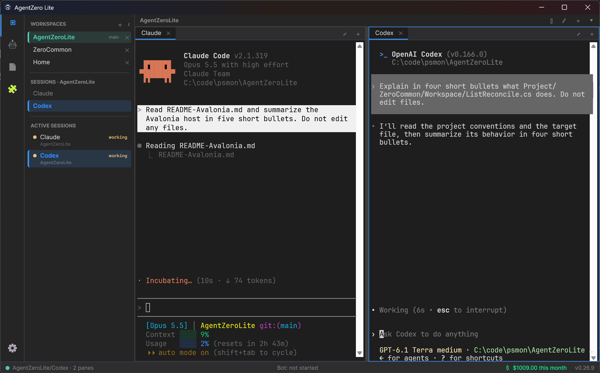
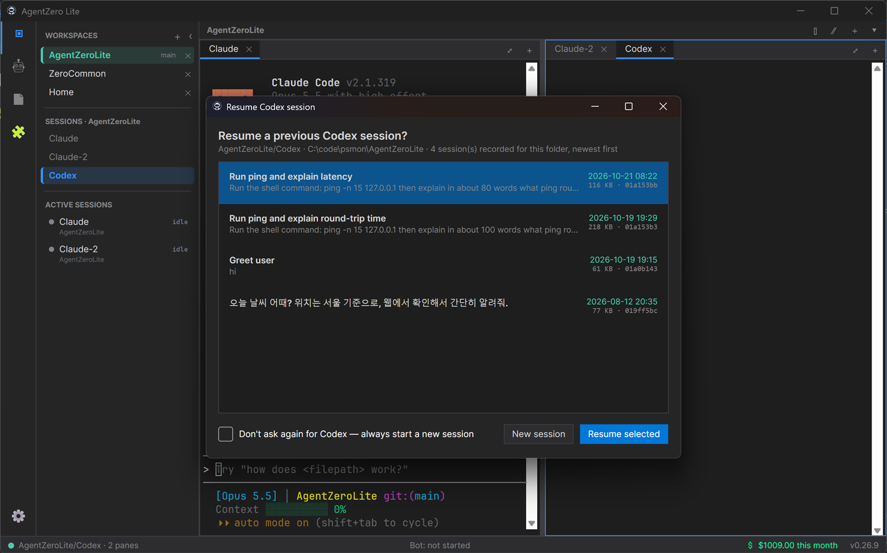
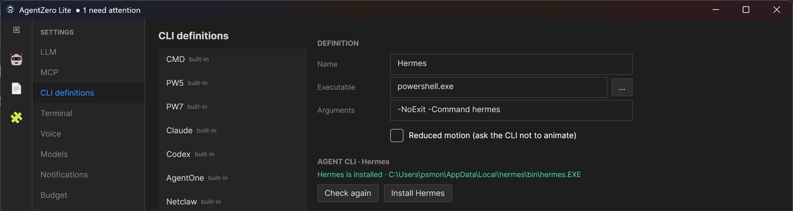
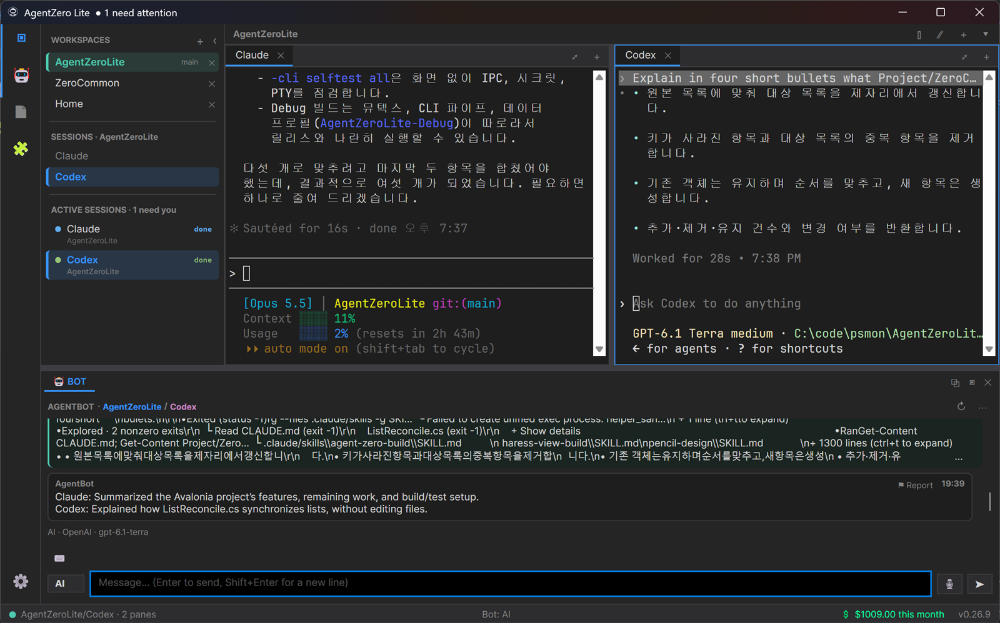
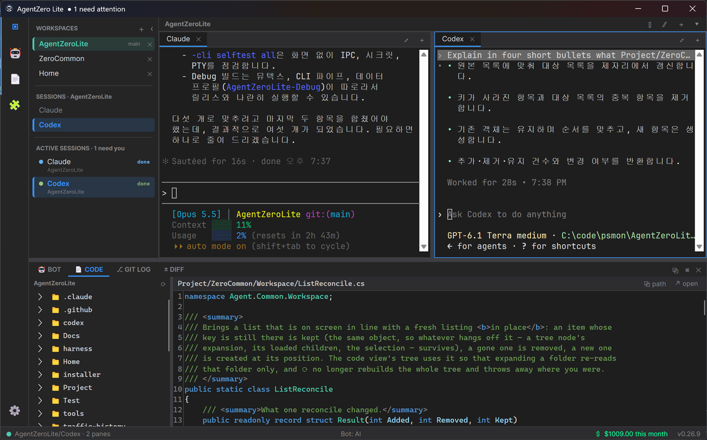
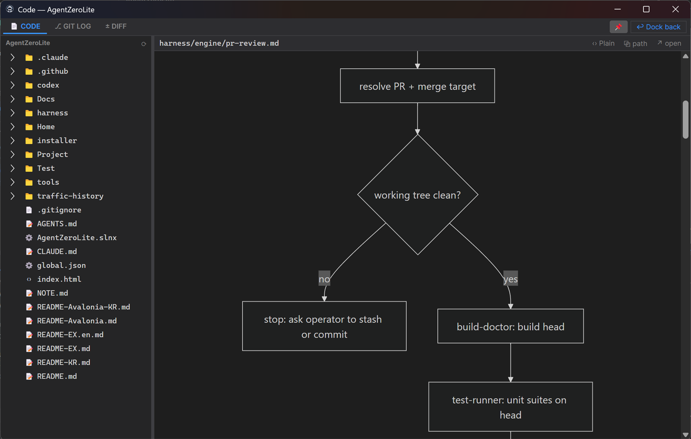
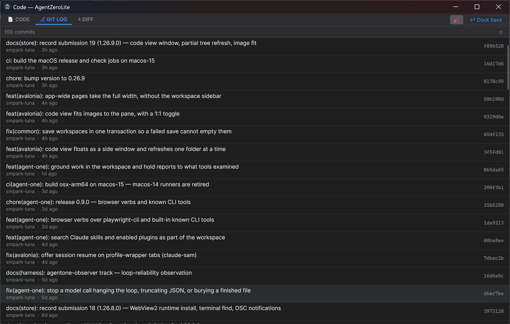
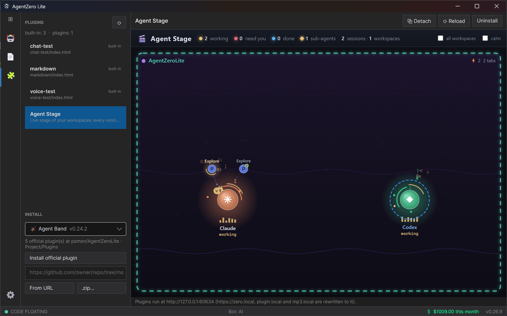
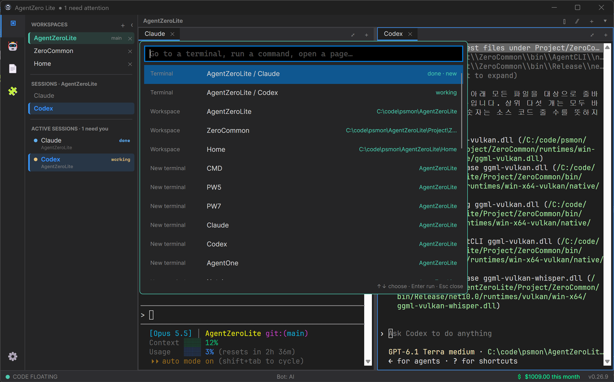

# AgentZero Lite

**이미 쓰고 있는 커맨드라인 AI 에이전트들의 데스크톱 거처 — Claude Code, Codex, 어떤 셸이든 한 창에 나란히.**

> 🇺🇸 English: [README.md](README.md)



Claude Code, Codex, PowerShell 같은 CLI를 진짜 터미널 탭으로 열고, 분할 화면으로 배치하고,
프로젝트마다 워크스페이스를 따로 둡니다. AgentZero Lite는 어느 에이전트가 일하는 중인지,
어느 쪽이 내 답을 기다리는지, 어느 쪽이 끝났는지 알려 줍니다. 내장 어시스턴트는 터미널을 읽고
대신 조작할 수 있고, 모든 기능은 어떤 셸에서든 스크립트로 다룰 수 있습니다.

계정도, 텔레메트리도 없습니다 — 설정과 기록은 내 PC에 남습니다. 오픈 소스입니다.

🎬 시연 영상 — Claude와 Codex 동시 제어:

<a href="https://www.youtube.com/watch?v=kXQjohrpA8o"></a>

## 설치

| 판 | 받는 곳 | 비고 |
|---|---|---|
| **Microsoft Store** (추천) | [apps.microsoft.com/detail/9NRHDFMD38H7](https://apps.microsoft.com/detail/9NRHDFMD38H7) | Windows 10/11 x64. 자동 업데이트. |
| Windows 설치판 | [Releases](https://github.com/psmon/AgentZeroLite/releases/latest) → `AgentZeroLite-v<ver>-Setup.exe` | 자가 포함 빌드라 .NET을 따로 설치할 필요가 없습니다. |
| Windows 포터블 | Releases → `AgentZeroLite-v<ver>-win-x64.zip` | 압축을 풀고 실행. |
| macOS (Apple Silicon) — 테스트 빌드 | Releases → `AgentZeroLite-v<ver>-osx-arm64.pkg` | 서명·공증 완료. 로컬 LLM 없음. v0.26.9에는 빠졌으니 다음 릴리스 전까지는 v0.26.8의 것을 쓰세요. |
| Ubuntu (x64) — 테스트 빌드 | `curl -fsSL https://psmon.github.io/AgentZeroLite/Home/install-linux.sh \| bash` | 최신 릴리스의 `.deb`. |

Store 판은 데이터(데이터베이스, 설정)를 패키지 안에 따로 보관하며, Releases 설치본과 공유하지
않습니다. 소개 페이지: <https://psmon.github.io/AgentZeroLite/Home/>

---

## 주요 기능

### 에이전트를 위한 터미널 — 탭, 분할 화면, 워크스페이스

- **진짜 터미널.** 탭 하나하나가 Windows 의사 콘솔(ConPTY)이고 xterm.js가 그립니다 — Claude Code,
  Codex, Hermes Agent, netclaw, PowerShell, CMD, 직접 추가한 어떤 프로그램이든. macOS와 Linux에서는
  zsh 또는 bash가 도는 진짜 PTY입니다.
- **분할 화면.** 오른쪽·아래로 나누고, 탭을 다른 칸으로 옮기고, 터미널을 별도 창으로 떼어 냈다가
  다시 붙일 수 있습니다 — 떼어 내도 계속 실행되고 화면도 그대로입니다.
- **워크스페이스.** 프로젝트 폴더마다 하나씩, 각자의 탭과 배치를 갖고 다음에 앱을 열 때 그대로
  복원됩니다. 사이드바에는 폴더의 git 브랜치와 worktree 목록이 보이고 — Claude Code와 Codex가
  만든 것도 포함 — 클릭 한 번으로 옮겨 갈 수 있습니다.
- **터미널 내 검색**(Ctrl+Shift+F) — 스크롤백 전체에서, 대소문자 구분과 정규식 지원.

### 나를 기다리는 에이전트를 바로 알기

사이드바의 **ACTIVE SESSIONS** 목록(맨 위 스크린샷)은 모든 워크스페이스에서 돌고 있는 터미널을
*working*(작업 중), *waiting*(내 답을 기다림), *done*(완료)으로 보여 줍니다. Claude Code, Codex,
Hermes Agent는 화면만이 아니라 각 에이전트가 스스로 남기는 상태 기록을 읽기 때문에, 아직 진행 중인
턴은 정말 끝날 때까지 *working*으로 남습니다. 에이전트가 일을 마치거나 질문을 하면 화면 구석에
작은 팝업이 뜨고 작업 표시줄 버튼이 깜박입니다. 누르면 그 터미널로 바로 갑니다
(설정 → Notifications). 표준 터미널 알림을 보내는 프로그램이면 무엇이든 같은 방식으로 뜹니다.

### 터미널을 열 때 이전 대화 이어가기



Claude Code나 Codex 탭을 열면, 그 에이전트가 이 폴더에서 이미 나눈 대화를 최신순으로 제목과 첫
프롬프트와 함께 보여 주고 — 새 세션도 고를 수 있습니다. "Don't ask again"으로 에이전트별로 끌 수
있습니다.

### 에이전트 CLI 설치 확인과 설치



설정 → CLI definitions에는 `+` 메뉴로 열 수 있는 셸과 에이전트가 모여 있습니다. 내장 에이전트
(Claude Code, Codex, AgentOne, netclaw, Hermes Agent)를 고르면 설치되어 있는지 확인하고, 없으면
설치해 줍니다 — npm으로, netclaw와 Hermes는 제작사의 설치 스크립트로. 두 번째 Claude 계정처럼
다른 명령도 직접 항목으로 추가할 수 있습니다.

### AgentBot — 터미널을 읽고 조작하는 어시스턴트



아래쪽 **BOT** 패널은 입력한 내용을 포커스된 터미널로 보내며, 모드가 셋입니다:

| 모드 | 하는 일 |
|---|---|
| **CHT** | 입력한 글을 활성 터미널에 칩니다. |
| **KEY** | 키를 그대로 넘깁니다 — Ctrl+C, 방향키, Tab. |
| **AI** | 터미널을 읽고, 입력을 보내고, 답을 기다리고, 에이전트 사이에 일을 전달하는 에이전트. |

AI 모드는 **내 PC의 로컬 모델**(Windows) 또는 설정 → LLM에 넣은 **OpenAI 호환 엔드포인트**에서
돌고, 설정 → MCP에서 추가하고 하나씩 허용한 **MCP 서버**의 도구를 부를 수 있습니다. **말로 걸 수도**
있습니다: 마이크 버튼을 누르고 말하면 내 PC에서 바로 받아 적습니다(NVIDIA Nemotron 스트리밍 음성
인식 — 한국어, 영어 등 여러 언어). 설정 → Voice에는 기기 내 음성 합성(TTS) 목소리도 있으며,
모델은 그곳에서 한 번만 내려받으면 됩니다.

### 코드 뷰, git 로그, diff 리뷰



**CODE** 탭(왼쪽 바의 📄 또는 Ctrl+Alt+E)은 워크스페이스의 파일을 보여 줍니다: VS Code 문법 강조,
패널에 맞춰 보이는 이미지, Mermaid 다이어그램까지 렌더링되는 Markdown. 폴더를 펼치거나 선택하면
새로 생긴 파일과 지워진 파일이 바로 반영됩니다.



별도 창으로 띄워 터미널 옆에 두고, 맨 위에 고정했다가, **Dock back**으로 되돌릴 수 있습니다.



**GIT LOG**는 로컬 git으로 읽은 워크스페이스의 최근 커밋을 보여 줍니다. **DIFF**는 새 파일을 포함한
작업 트리의 변경을 보여 주고, 줄마다 메모를 달아 그 메모들을 터미널의 에이전트나 AgentBot에 한꺼번에
보낼 수 있습니다.

### Agent Stage와 플러그인



**Plugins** 페이지(🧩)는 웹 플러그인을 앱 안에서 실행합니다. **Agent Stage**는 워크스페이스를 무대로,
터미널을 에이전트로 그립니다 — 일하는 동안 움직이고, 내가 필요하면 깜박이고, Claude Code·Codex·Hermes가
띄운 서브에이전트를 주위에 무리로 보여 줍니다. 에이전트를 누르면 그 터미널로 갑니다. 그 밖의 공식
플러그인 — Voice Note(화자 구분이 되는 받아쓰기), Agent Band(실시간 음악 인식), 토큰 대시보드 — 는
같은 페이지의 목록에서 설치하거나, GitHub 폴더나 `.zip`으로 설치합니다. 플러그인은 별도 창으로 떼어
낼 수 있습니다.

### 명령 팔레트, 예산, 단축키



- **명령 팔레트**(Ctrl+Shift+P) — 어떤 터미널, 워크스페이스, 페이지, 명령으로든 바로 이동.
- **Budget** — 터미널의 에이전트들이 이번 달 쓴 비용을 모델별·프로젝트별로, 선택한 월 한도와 함께
  보여 줍니다. 이번 달 지출은 상태 바에 나옵니다. 가격은 직접 고칠 수 있습니다.
- **Shortcuts** — 설정 → Shortcuts에서 단축키를 바꿉니다.

### 휴대폰에서 터미널 쓰기 — Remote (다운로드판)

**📡 Remote** 페이지에서 서버를 켜면, 같은 네트워크의 휴대폰이나 다른 PC 브라우저에서 이 PC의 터미널을
보고 입력할 수 있습니다. 처음 한 번은 앱에서 발급한 일회용 코드(8자리, 5분)로 브라우저를 페어링하고,
그 뒤에는 그 브라우저가 키를 간직합니다(앱에는 해시만 저장, 페이지에서 언제든 회수). 터미널은 PC와 같은
열·행으로 그려지고, 휴대폰에 없는 Esc · Tab · Ctrl+C · 방향키 버튼과 한 줄 보내기 입력칸이 있습니다.
서버를 켜기 전에는 아무것도 수신 대기하지 않습니다. **Releases의 설치 파일·포터블·macOS·Ubuntu 빌드에만**
있고, Microsoft Store판과 Mac App Store판에는 빠져 있습니다.

### 어떤 셸에서든 스크립트로

위의 기능은 모두 같은 실행 파일로 스크립트에서 — 또는 다른 에이전트가 — 다룰 수 있습니다:

```powershell
AgentZeroLite.exe -cli terminal-list                          # 워크스페이스와 탭
AgentZeroLite.exe -cli terminal-send 0 1 "run the tests"      # 워크스페이스 0, 탭 1에 입력
AgentZeroLite.exe -cli terminal-wait 0 1 --until done         # 에이전트가 끝날 때까지 대기
AgentZeroLite.exe -cli terminal-read 0 1 --last 2000          # 답한 내용 읽기
AgentZeroLite.exe -cli bot-ask "what is the Codex tab doing?" # AI 모드의 AgentBot에 질문
```

| 명령 | 하는 일 |
|---|---|
| `status`, `terminal-list` | 앱 상태, 워크스페이스와 탭 |
| `terminal-send` / `terminal-key` / `terminal-read` / `terminal-wait` | 입력, 키 누르기, 화면 읽기, 에이전트 상태 대기 |
| `terminal-alias` | 터미널에 이름을 붙이고 `--alias <name>`으로 지정 |
| `agent-state`, `attention` | 터미널별 에이전트 상태, "나를 기다림" 알림 |
| `layout` | 칸 나누기·옮기기·포커스, 워크스페이스 전환 |
| `bot-chat`, `bot-ask` | AgentBot에 메시지 넣기, AI 모드로 질문 |
| `code`, `worktree`, `plugin`, `mcp` | 코드 뷰, git worktree, 플러그인, MCP 서버 |
| `cost` | 이번 달 에이전트 지출(GUI 없이도 동작) |
| `remote` | Remote 서버 상태·시작·중지, 페어링 코드 발급(다운로드판만) |

`AgentZeroLite.exe -cli help`가 전체 목록을 보여 주고, `-cli help agentzero`는 에이전트를 위해 쓴
안내서입니다 — Claude나 Codex 탭에 한 번 가르쳐 두면 에이전트끼리 서로의 터미널과 대화할 수 있습니다.

---

## 개인정보

AgentZero Lite에는 계정이 없고 텔레메트리를 보내지 않습니다. 터미널, 설정, 기록은 내 PC에 남고,
입력한 API 키는 암호화해 저장합니다(Windows는 DPAPI). [개인정보 처리방침](https://psmon.github.io/AgentZeroLite/Home/privacy-policy.html)

## 소스에서 빌드

```bash
dotnet build Project/AgentZeroAvalonia/AgentZeroAvalonia.csproj -c Debug
Project/AgentZeroAvalonia/bin/Debug/net10.0/AgentZeroLite.exe
dotnet test  Project/AgentZeroAvalonia.Tests/AgentZeroAvalonia.Tests.csproj
dotnet test  Project/ZeroCommon.Tests/ZeroCommon.Tests.csproj
```

.NET 10 SDK가 필요합니다. Debug 빌드는 설치된 릴리스 옆에서 자기 데이터로 따로 돕니다. macOS·Linux
빌드, 패키징, 구조는 [README-Avalonia-KR.md](README-Avalonia-KR.md)에 있습니다.

## 더 보기

| 문서 | 내용 |
|---|---|
| [README-Avalonia-KR.md](README-Avalonia-KR.md) | 공식 호스트: 스택, Windows / macOS / Linux 빌드, Store 패키징, 설계 |
| [README-EX.md](README-EX.md) | 기능을 먼저 시험하는 WPF 참조 빌드의 확장 매뉴얼 |
| [Project/AgentOne/README.md](Project/AgentOne/README.md) | 이 저장소의 실험적 독립 CLI 에이전트 `agent-one` |
| [Docs/avalonia-v2/microsoft-store.md](Docs/avalonia-v2/microsoft-store.md) | Microsoft Store 제출 기록 |

문의와 이슈: <https://github.com/psmon/AgentZeroLite/issues>

---

🚧 **In preparation** · <https://blumn.ai/>

<sub>design coaching: bk-mon · dev: psmon</sub>
