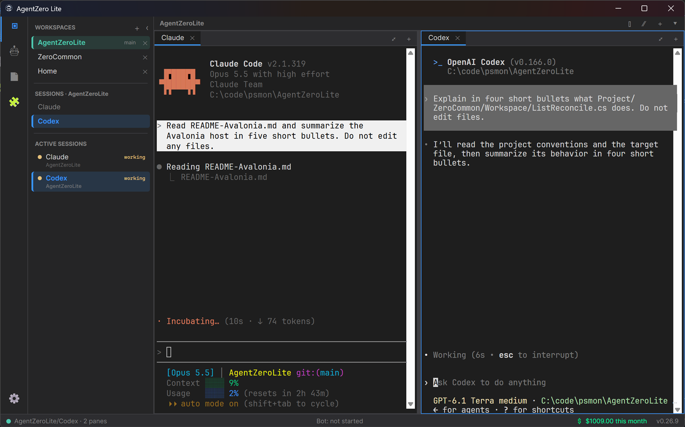
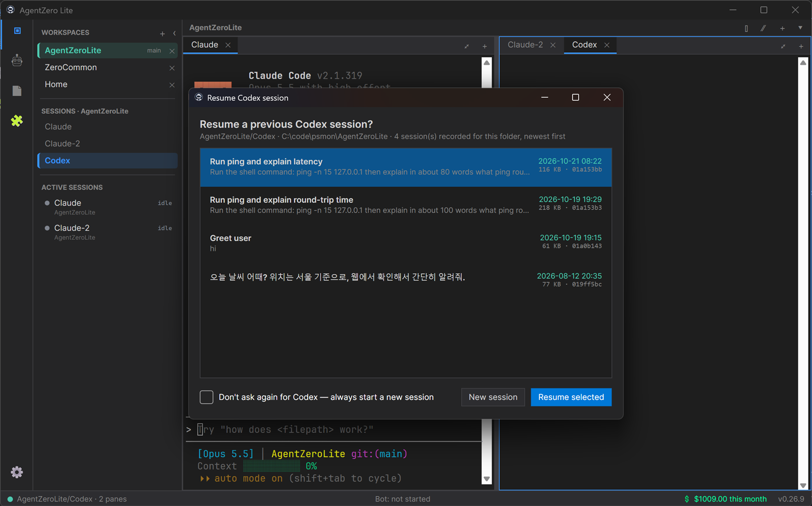
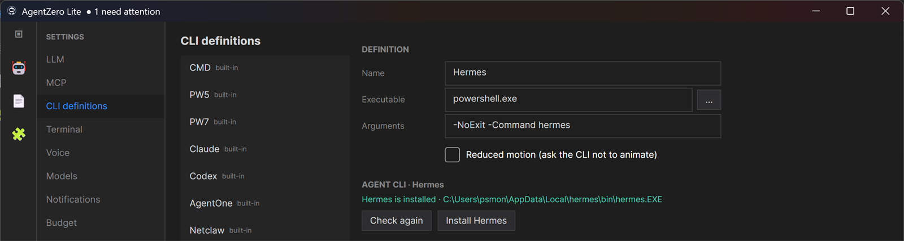
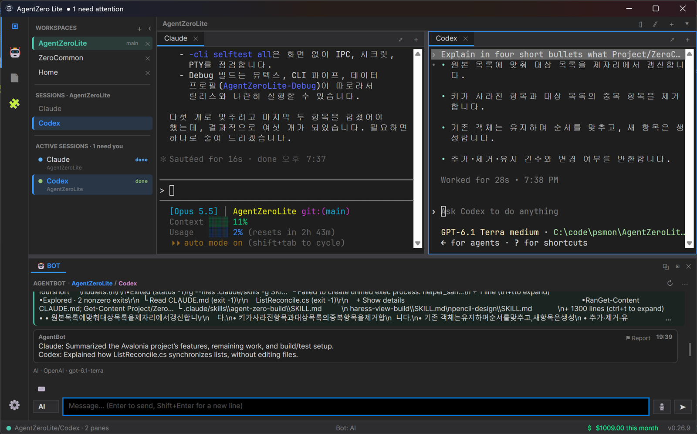
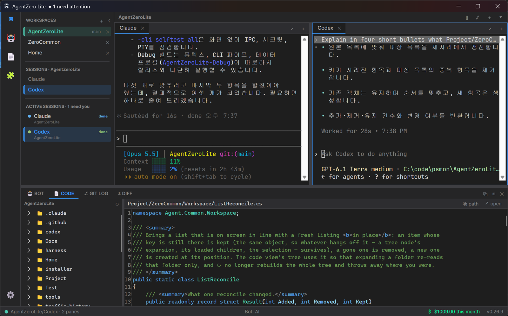
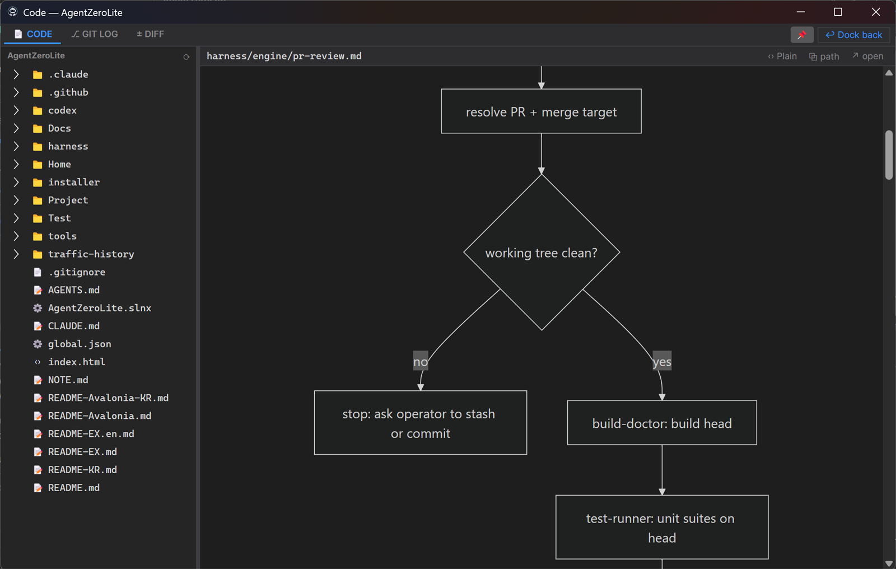
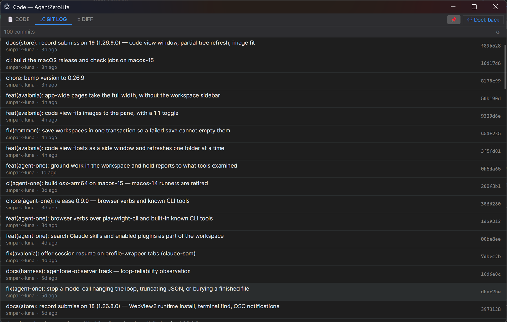
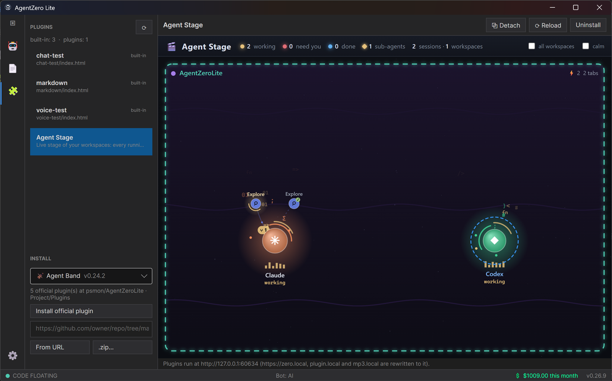
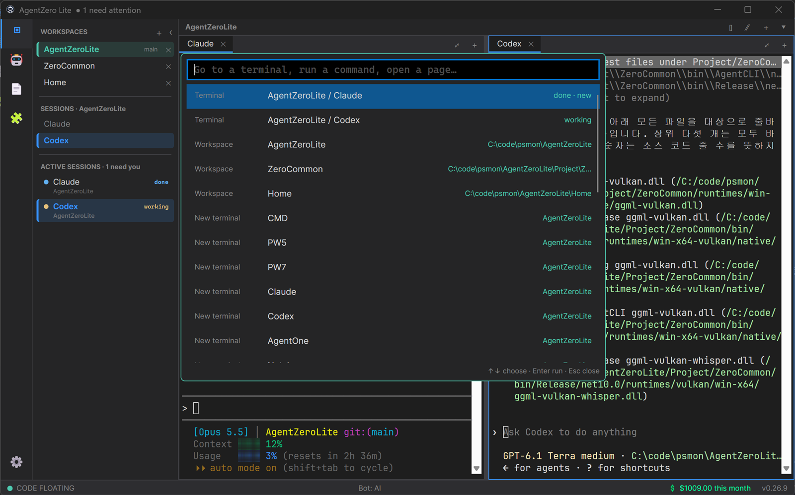

# AgentZero Lite

**A desktop home for the command-line AI agents you already use — Claude Code, Codex and any shell, side by side in one window.**

> 🇰🇷 한국어: [README-KR.md](README-KR.md)



Open Claude Code, Codex, PowerShell or any other CLI in real terminal tabs, arrange them in split
panes, and keep each project in its own workspace. AgentZero Lite tells you which agent is working,
which one is waiting for you and which one is done; a built-in assistant can read the terminals
and drive them for you; and everything is scriptable from any shell.

No account, no telemetry — your settings and history stay on your PC. Open source.

🎬 Demo — driving Claude and Codex in parallel:

<a href="https://www.youtube.com/watch?v=Bpj8n29W6wY"></a>

## Install

| Edition | Where | Notes |
|---|---|---|
| **Microsoft Store** (recommended) | [apps.microsoft.com/detail/9NRHDFMD38H7](https://apps.microsoft.com/detail/9NRHDFMD38H7) | Windows 10/11 x64. Updates itself. |
| Windows installer | [Releases](https://github.com/psmon/AgentZeroLite/releases/latest) → `AgentZeroLite-v<ver>-Setup.exe` | Self-contained, no .NET to install. |
| Windows portable | Releases → `AgentZeroLite-v<ver>-win-x64.zip` | Unzip and run. |
| macOS (Apple Silicon) — test build | Releases → `AgentZeroLite-v<ver>-osx-arm64.pkg` | Signed and notarized. No local LLM. v0.26.9 shipped without it — use v0.26.8's until the next release. |
| Ubuntu (x64) — test build | `curl -fsSL https://psmon.github.io/AgentZeroLite/Home/install-linux.sh \| bash` | `.deb` from the newest release. |

The Store edition keeps its data (database, settings) inside its package, separate from a
Releases install. Home page: <https://psmon.github.io/AgentZeroLite/Home/>

---

## What you get

### Terminals for your agents — tabs, split panes, workspaces

- **Real terminals.** Each tab is a Windows pseudo-console (ConPTY) drawn by xterm.js — Claude Code,
  Codex, Hermes Agent, netclaw, PowerShell, CMD or any program you add. On macOS and Linux it is a
  real PTY with zsh or bash.
- **Split panes.** Split right or down, move tabs between panes, or detach a terminal into its own
  window and dock it back — it keeps running and keeps its screen.
- **Workspaces.** One per project folder, each with its own tabs and layout, restored the next time
  you open the app. The sidebar shows the folder's git branch and lists its worktrees — including
  the ones Claude Code and Codex create — so you can switch to one with a click.
- **Find in terminal** (Ctrl+Shift+F) across the whole scrollback, with match case and regular
  expressions.

### Know which agent needs you

The **ACTIVE SESSIONS** list in the sidebar (top screenshot) shows every running terminal across
all workspaces as *working*, *waiting for you* or *done*. For Claude Code, Codex and Hermes Agent
the state comes from what each agent records about itself, not only from the screen, so a turn that
is still running stays *working* until it really ends. When an agent finishes or asks a question, a
small popup appears in the corner of the screen and the taskbar button flashes; click it to jump
to that terminal (Settings → Notifications). Any program that sends a standard terminal
notification shows up the same way.

### Resume a conversation when its terminal opens



Opening a Claude Code or Codex tab offers the conversations that agent already has for this folder,
newest first, with their title and first prompt — or a new session. "Don't ask again" turns it off
per agent.

### Agent CLIs checked and installed for you



Settings → CLI definitions holds the shells and agents the `+` menu can open. Selecting a built-in
agent (Claude Code, Codex, AgentOne, netclaw, Hermes Agent) checks whether it is installed and
offers to install it — with npm, or with the vendor's own install script for netclaw and Hermes.
Add your own entries for any other command, such as a second Claude account.

### AgentBot — an assistant that reads and drives your terminals



The **BOT** panel at the bottom sends what you type to the terminal in focus, and has three modes:

| Mode | What it does |
|---|---|
| **CHT** | Types your text into the active terminal. |
| **KEY** | Passes keys straight through — Ctrl+C, arrows, Tab. |
| **AI** | An agent that reads the terminals, sends them input, waits for the answer and relays work between agents. |

AI mode runs on a **local model on your PC** (Windows) or on **any OpenAI-compatible endpoint** you
set in Settings → LLM, and can call tools from **MCP servers** you add and allow one by one in
Settings → MCP. You can also **talk to it**: the microphone button transcribes as you speak, on your
PC (NVIDIA Nemotron streaming speech recognition — Korean, English and many more languages).
Settings → Voice also has on-device text-to-speech voices; models are downloaded once from there.

### Code view, git log and diff review



The **CODE** tab (📄 on the left bar, or Ctrl+Alt+E) browses the workspace's files: VS Code
syntax highlighting, images that fit the panel, and Markdown rendered with Mermaid diagrams.
New and deleted files show up when you open or select a folder.



Float it into its own window beside your terminals, pin it on top, and bring it back with
**Dock back**.



**GIT LOG** lists the workspace's recent commits, read with your local git. **DIFF** shows the
working tree's changes, new files included; add a note to any line and send all the notes to the
agent in the terminal or to AgentBot.

### Agent Stage and other plugins



The **Plugins** page (🧩) runs web plugins inside the app. **Agent Stage** draws each workspace as a
stage and each terminal as an agent that animates while it works, pulses when it needs you, and
shows the sub-agents Claude Code, Codex and Hermes start as a crew around it. Click an agent to jump
to its terminal. Other official plugins — Voice Note (speech-to-text with speaker labels), Agent
Band (live music recognition), token dashboards — install from the list on the same page, or from a
GitHub folder or a `.zip`. A plugin can be detached into its own window.

### Command palette, budget and shortcuts



- **Command palette** (Ctrl+Shift+P) — jump to any terminal, workspace, page or command.
- **Budget** — what the agents in your terminals have cost this month, by model and by project,
  against an optional monthly cap; the month's spend is on the status bar. Prices are editable.
- **Shortcuts** — Settings → Shortcuts changes the keys.

### Scriptable from any shell

Everything above can be driven by a script — or by another agent — through the same executable:

```powershell
AgentZeroLite.exe -cli terminal-list                          # workspaces and tabs
AgentZeroLite.exe -cli terminal-send 0 1 "run the tests"      # type into workspace 0, tab 1
AgentZeroLite.exe -cli terminal-wait 0 1 --until done         # wait for the agent to finish
AgentZeroLite.exe -cli terminal-read 0 1 --last 2000          # read what it answered
AgentZeroLite.exe -cli bot-ask "what is the Codex tab doing?" # ask AgentBot in AI mode
```

| Command | What it does |
|---|---|
| `status`, `terminal-list` | App state; workspaces and their tabs |
| `terminal-send` / `terminal-key` / `terminal-read` / `terminal-wait` | Type, press keys, read the screen, wait for an agent state |
| `terminal-alias` | Name a terminal and target it with `--alias <name>` |
| `agent-state`, `attention` | Each terminal's agent state; the "needs you" notifications |
| `layout` | Split, move and focus panes; switch workspaces |
| `bot-chat`, `bot-ask` | Post into AgentBot; ask it a question in AI mode |
| `code`, `worktree`, `plugin`, `mcp` | Code view, git worktrees, plugins, MCP servers |
| `cost` | This month's agent spend (no GUI needed) |

`AgentZeroLite.exe -cli help` prints the full list, and `-cli help agentzero` is a guide written
for agents — teach it to a Claude or Codex tab once and the agents can talk to each other's
terminals.

---

## Privacy

AgentZero Lite has no account and sends no telemetry. Terminals, settings and history stay on
your PC, and API keys you enter are encrypted at rest (DPAPI on Windows). [Privacy policy](https://psmon.github.io/AgentZeroLite/Home/privacy-policy.html)

## Build from source

```bash
dotnet build Project/AgentZeroAvalonia/AgentZeroAvalonia.csproj -c Debug
Project/AgentZeroAvalonia/bin/Debug/net10.0/AgentZeroLite.exe
dotnet test  Project/AgentZeroAvalonia.Tests/AgentZeroAvalonia.Tests.csproj
dotnet test  Project/ZeroCommon.Tests/ZeroCommon.Tests.csproj
```

.NET 10 SDK. A Debug build runs beside an installed release with its own data. macOS and Linux
builds, packaging and the architecture are in [README-Avalonia.md](README-Avalonia.md).

## More

| Document | What it covers |
|---|---|
| [README-Avalonia.md](README-Avalonia.md) | The official host: stack, builds for Windows / macOS / Linux, Store packaging, design |
| [README-EX.en.md](README-EX.en.md) | Extended manual of the WPF reference build, where features are tried first |
| [Project/AgentOne/README.md](Project/AgentOne/README.md) | `agent-one`, an experimental standalone CLI agent from this repository |
| [Docs/avalonia-v2/microsoft-store.md](Docs/avalonia-v2/microsoft-store.md) | Microsoft Store submission history (Korean) |

Issues and questions: <https://github.com/psmon/AgentZeroLite/issues>

---

🚧 **In preparation** · <https://blumn.ai/>

<sub>design coaching: bk-mon · dev: psmon</sub>
